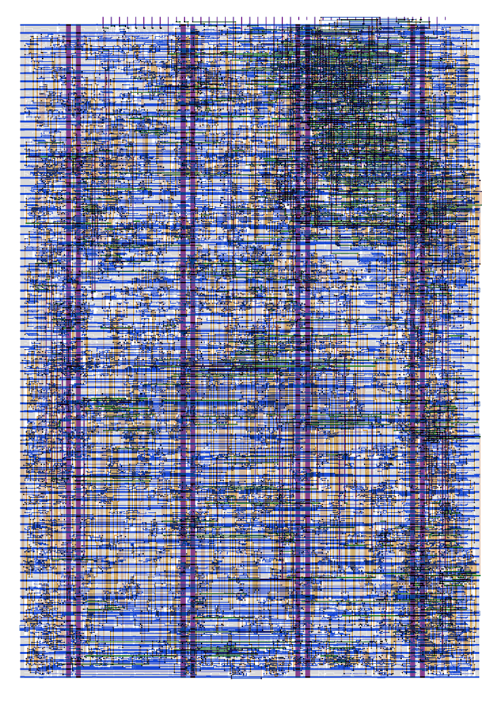
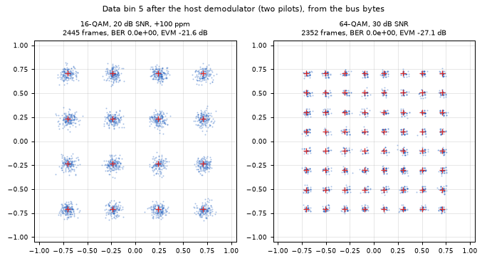

<!---

This file is used to generate your project datasheet. Please fill in the information below and delete any unused
sections.

You can also include images in this folder and reference them in the markdown. Each image must be less than
512 kb in size, and the combined size of all images must be less than 1 MB.
-->

## How it works

This chip is a **16-point streaming FFT for real-valued samples, with its own OFDM symbol timing**. One 8-bit
ADC sample comes in on `ui_in` every clock (32 MHz = 32 MS/s). One byte goes out on `uo_out` every clock.
That byte is the I (real) or Q (imaginary) part of one of the 8 informative frequency bins. Bin spacing is
2 MHz, from DC to 14 MHz.

The input is expected to be a **mini-OFDM signal**: symbols of 16 samples preceded by a 4-sample cyclic prefix
(CP), 20 samples = 625 ns per symbol. A sign-only CP correlator finds the symbol boundaries without any sync
pin, then raises `LOCK`. While locked, the FFT datapath is **paused for the 4 CP samples of every symbol**, so
each 16-sample FFT window holds exactly one symbol. Each window starts 2 samples into the CP, with a
tolerance of about ±2 samples. The correlator tracks sample-rate offsets of at least ±100 ppm, re-phasing by
one sample at a time inside the pause ("slips"). Every frame on the bus is flagged by `SOF` (byte 0) and
`VALID` (clean frame), so a downstream reader or demodulator can use the bins directly.

```
ui_in[7:0]: ADC samples, offset binary
     │
     ▼
capture reg (CFG_EDGE) ─► ~d[7] ─┬─► sign ─► CP correlator,
                                 │           symbol-phase counter
                                 │           (clk) ─► LOCK, DBG,
                                 │                    SOF, VALID
                                 │                │ run
                                 │                ▼
                                 │       clock gate (dlclkp)
                                 │                │ clk_dp
                                 ▼                ▼
          radix-2² SDF FFT, N = 16, 8-bit I/Q (on clk_dp)
                                 │
                                 ▼
          I/Q byte tail ─► uo_out[7:0]

SCLK, ADC_CLK: flop-made copies of clk ─► uio[0], uio[3]
```

* **FFT:** radix-2² single-path delay feedback (SDF), decimation in frequency, real input, 8-bit I/Q. Four
  butterfly stages with delay lines of 8, 4, 2 and 1 samples (BF2I, BF2II, BF2I, BF2II) and one complex twiddle
  multiplier between the two radix-2² stages: a 16-entry W16 table of Q1.7 coefficients, exact products floored
  back to 8 bits with saturation, an exact bypass for W⁰, Booth-encoded multipliers in synthesis. The output comes
  in bit-reversed order, one complex bin per clock; the frame counter is the low 4 bits of the symbol-phase
  counter. Every butterfly stage except the last truncates with ÷2. The last stage keeps the full sum and
  difference and saturates them to 8 bits (±127/−128), for a **net gain of 2/16**. The −128 corner of the −j
  multiply also saturates. Only the delay-line shift registers hold data; there are no memories.
  - A real tone of amplitude A (LSB) at bin k reads about **A** in that bin, so a full-scale tone reads about 127.
  - A DC input reads as **2 × its value** in bin 0.
* **Saturation:** values outside 8 bits clamp to the rail with the correct sign; they never wrap. This can only
  happen when:
  - the DC level (input mean) is **64 LSB or more** away from mid-scale (0x80), so bin 0 reads 127 or −128;
  - or a near-full-scale tone (from 101–127 LSB) sits **midway between bins next to DC or Nyquist**, so its
    leakage overloads bins 0/1 or 7.

  Bin-centred tones up to full scale, and the mini-OFDM test signal up to 42 LSB per carrier with ±20 LSB DC offset, never
  saturate (verified in the model and the RTL).
* **Fixed-point quality (model, bit-exact with the RTL):** against an ideal float FFT × 2/16 of random full-scale
  frames (8-bit clipped reference, 2,000 frames), the error is at most 3.78 LSB, 1.19 LSB rms. Relative to the
  signal, that is 3.3 dB lower than a ÷2-per-stage (1/N) pipeline. With the test signal below, the EVM floor is
  about −28 dB (64-QAM, model).
* **Hermitian byte stream (why 8 bins fit in 16 bytes):** for a real input the 16-point spectrum is
  conjugate-symmetric, X[16 − k] = X\*[k]: bins 9–15 repeat bins 7–1, and bins 0 and 8 are real. In each 16-clock
  frame the pipeline's even output slots t = 0, 2, …, 14 carry bins k = bitrev(t) = 0, 4, 2, 6, 1, 5, 3, 7 (all
  below 8) and the odd slots carry their mirror images. The output tail sends the I part of each even-slot bin in
  that slot and holds its Q part for the following odd slot, dropping the redundant mirror bins. So the bus carries
  one byte per input sample with no FIFO: 16 bytes = 8 complex bins per 16 samples. The Nyquist bin (8) is not
  sent; byte 1 (Q of bin 0) is always 0 and reserved.
* **Timing recovery:** a 16 × 1-bit sign delay line is compared against the incoming sign over the CP
  window. It counts ±1 per match/mismatch over K = 16 symbols. A sequential search over the 20 symbol phases
  locks at ≥ 48 of 64 matches. Tracking uses early/late comparisons with hysteresis 8 every 16 symbols, and
  unlocks after two weak on-time measurements (< 24 of 64).
* **Pause:** a single integrated clock gate stops the FFT clock for 4 cycles per symbol. The correlator and
  the bus timing run on the ungated clock.

### Pinout

| Pin | Name | Dir | Function |
| --- | --- | --- | --- |
| `clk` | clk | in | 32 MHz system clock = ADC sample rate |
| `rst_n` | rst_n | in | Active-low reset of the control logic, through a two-flop synchroniser (acts 2 clocks after the pin; see Reset). The FFT data registers are not reset. |
| `ui_in[7:0]` | ADC_D0..7 | in | ADC sample, **offset binary** (0x80 = 0, 0x00 = −128, 0xFF = +127) |
| `uo_out[7:0]` | IO0..7 | out | Bus data byte: two's complement, I/Q of one bin per byte (see frame structure) |
| `uio[0]` | SCLK | out | Bus clock: 32 MHz, continuous (also during pauses and before lock) |
| `uio[1]` | SOF | out | 1 for one clock with byte 0 (I of bin 0) of every frame |
| `uio[2]` | VALID | out | 1 for the 16 bytes of a clean frame (see below); 0 otherwise |
| `uio[3]` | ADC_CLK | out | Same waveform as SCLK, for clocking an ADC from the chip (bench fallback) |
| `uio[4]` | LOCK | out | 1 while the correlator is tracking OFDM symbols |
| `uio[5]` | CFG_EDGE | in | ADC capture edge: 0 = rising clock edge (default), 1 = falling edge (then re-registered on the rising edge) |
| `uio[6]` | — | in | Unused (no function; CP length is fixed at 4) |
| `uio[7]` | DBG | out | One-clock pulse on every tracking slip (re-phase by one sample) |

`uio_oe` is constant `1001_1111`. `ena` is ignored.

### Bus timing

`uo_out`, `SOF`, `VALID`, `LOCK` and `DBG` are registers that change only after the **rising** clock edge.
`SCLK` is made from two flops (a toggle on the rising edge, a follower on the falling edge, XOR). It goes high
after each rising edge and low after each falling edge, so it rises together with the data.

**Sample the bus on the falling edge of SCLK.** The data then has about half a clock period of margin on each side
of the sampling edge.

Post-layout timing at the project's own output pins (static timing on the extracted layout, with pessimistic
on-chip variation: clock paths ±10 %, data paths ±5 %; 33 fF load per pin; ff = both RC corners):

| | slow (ss, 100 °C, 1.60 V) | typical (tt, 25 °C, 1.80 V) | fast (ff, −40 °C, 1.95 V) |
| --- | --- | --- | --- |
| rising `clk` → SCLK rises | 2.7–3.3 ns | 1.5–1.8 ns | 1.0–1.2 ns |
| falling `clk` → SCLK falls | 2.7–3.2 ns | 1.4–1.7 ns | 0.9–1.2 ns |
| rising `clk` → data, SOF, VALID, LOCK, DBG change | 2.3–3.2 ns | 1.2–1.7 ns | 0.8–1.2 ns |
| data change relative to SCLK rising | −1.0 to +0.5 ns | −0.5 to +0.3 ns | −0.4 to +0.2 ns |
| **data valid before SCLK falls (setup)** | **≥ 15.0 ns** | ≥ 15.2 ns | ≥ 15.3 ns |
| **data held after SCLK falls (hold)** | **≥ 14.7 ns** | ≥ 15.1 ns | ≥ 15.3 ns |

`ADC_CLK` has the same timing as SCLK (within 0.09 ns). A transistor-level simulation of the extracted output
stages at the typical corner gives clock-to-output delays 6–16 % shorter than the static timing, so the table is
conservative. The Tiny Tapeout output multiplexer and pads come after these pins. They add a delay that SCLK and
the data share, and some pin-to-pin skew, which is not characterised here. That skew (estimated below 2 ns)
comes off the setup and hold margins above.

```
clk      __/‾‾‾\___/‾‾‾\___/‾‾‾\___/‾‾‾\___/‾‾‾\___/‾‾‾\__
SCLK     __/‾‾‾\___/‾‾‾\___/‾‾‾\___/‾‾‾\___/‾‾‾\___/‾‾‾\__
IO[7:0]  ==X  I0  X  Q0  X  I4  X  Q4  X  I2  X  Q2  X==
SOF      __/‾‾‾‾‾‾‾\______________________________________
VALID    __/‾‾‾‾‾‾‾‾‾‾‾‾‾‾‾‾‾‾‾‾‾‾‾‾‾‾‾‾‾‾‾‾‾‾‾‾‾‾‾‾‾‾‾‾‾‾‾
sample on SCLK ↓:  ^       ^       ^       ^       ^
```

### Frame structure and pause

While locked, the bus repeats one 20-clock pattern per OFDM symbol:

| clock in symbol | 0 | 1 | 2 | 3 | 4 | 5 | 6 | 7 | 8 | 9 | 10 | 11 | 12 | 13 | 14 | 15 | 16–19 |
| --- | --- | --- | --- | --- | --- | --- | --- | --- | --- | --- | --- | --- | --- | --- | --- | --- | --- |
| byte | I₀ | Q₀ | I₄ | Q₄ | I₂ | Q₂ | I₆ | Q₆ | I₁ | Q₁ | I₅ | Q₅ | I₃ | Q₃ | I₇ | Q₇ | don't care |
| SOF | 1 | 0 | 0 | 0 | 0 | 0 | 0 | 0 | 0 | 0 | 0 | 0 | 0 | 0 | 0 | 0 | 0 |
| VALID | 1 | 1 | 1 | 1 | 1 | 1 | 1 | 1 | 1 | 1 | 1 | 1 | 1 | 1 | 1 | 1 | 0 |

* **Byte order:** I then Q of the same bin. Values are signed 8-bit, with gain 2/16, saturated (see Saturation).
  For a real input, Q₀ (byte 1) is always 0; it is reserved and readers ignore it.
* **Bin order** (bit-reversed even slots, confirmed through the pins):

  | byte pair | 0–1 | 2–3 | 4–5 | 6–7 | 8–9 | 10–11 | 12–13 | 14–15 |
  | --- | --- | --- | --- | --- | --- | --- | --- | --- |
  | bin k | 0 | 4 | 2 | 6 | 1 | 5 | 3 | 7 |
  | frequency | DC | 8 MHz | 4 MHz | 12 MHz | 2 MHz | 10 MHz | 6 MHz | 14 MHz |

* **Pause:** for the 4 CP clocks, `VALID` = 0 and the data lines are don't-care. `SCLK` keeps running.
* **Slips:** a slip makes one symbol 19 or 21 clocks long (SOF-to-SOF), pulses `DBG`, and clears `VALID` for the
  one frame in flight. That is the frame whose `SOF` is at or after the `DBG` pulse. Under a constant
  frequency offset, the net slip count equals the sample drift.
* **Window phase:** each window starts about 2 samples into the CP. Bin k therefore carries a phase ramp of
  2π·k·(2 + e)/16, where e is the residual timing error (a few samples at most). A demodulator measures the
  ramp from two pilots.

### LOCK / VALID / SOF semantics

* **LOCK** rises when the correlator has confirmed the CP position: at 20 dB SNR a median 0.10 ms after the signal
  appears, 95 % within 0.19 ms (model). It falls after two consecutive weak measurements (74–130 symbols, i.e.
  46–81 µs after the signal is replaced by noise; model, 20 runs) and on reset.
* **VALID** = 1 only for the 16 bytes of a frame that was captured entirely while locked and was not hit by a
  slip. The first frame after LOCK rises is invalid (captured before lock). Before LOCK, VALID = 0 and the bus
  content is unspecified.
* **SOF** marks byte 0 of every frame, valid or not. Use it together with VALID.

### Reset

`rst_n` is synchronised by two flip-flops on `clk`, and the synchronised signal drives every reset in the chip. A
level on `rst_n` seen at rising edge k takes effect at edge k + 2, for both assertion and release. Hold `rst_n` low
for at least 3 clocks.

* **While reset is active:**
  - the correlator is in acquisition, and `LOCK`, `VALID`, `SOF` and `DBG` are 0;
  - SCLK and ADC_CLK idle low. In the clock where reset takes effect they may still finish one full-width pulse;
    they never produce a short pulse;
  - the FFT clock keeps running (the clock gate is open), so the pipeline flushes.
* **Not cleared by reset (by design):** the FFT delay lines, the correlator's sign line, the ADC capture
  registers and the CFG_EDGE register. They refill within one frame, and VALID stays 0 until they hold real
  data.
* **After release:**
  - SCLK and ADC_CLK restart at the first rising edge;
  - the chip re-acquires the OFDM symbols: 176–209 symbols (0.11–0.13 ms) at 30 dB in simulation, released at
    8 different clock phases, and a median 0.10 ms at 20 dB (model);
  - the first VALID frame follows one frame after LOCK.
* **State-machine safety:** if the correlator's state register ever holds an unused code, the next clock returns
  it to acquisition with LOCK = 0.

### Latency

The last sample of an FFT window is captured at clock edge E. Its frame's SOF and byte 0 appear after edge
**E + 5** (CP + 1), and the last byte after edge E + 20. The first sample of the window → byte 0: **20 clocks**
(625 ns). With CFG_EDGE = 1 and a late ADC (t_co 19–30 ns), add one clock.

### Configuration

* **CFG_EDGE** (`uio[5]`, static; set it before releasing reset): chooses which clock edge captures the ADC data.
  The ADC and the chip share one clock source, so ADC data arrives t_co after the clock edge. Simulated with
  ±2.5 ns of uncertainty (pin-to-pin skew plus flop setup/hold) at 32 MHz:

  | ADC t_co (data valid after the clock edge) | use |
  | --- | --- |
  | 0 – 2 ns | CFG_EDGE = 1 |
  | 3 – 13 ns | either (0 is the default) |
  | 14 – 18 ns | CFG_EDGE = 0 |
  | 19 – 28 ns | either (CFG_EDGE = 1 adds one clock of latency) |
  | 29 – 30 ns | CFG_EDGE = 1 |

* There is no CP-length setting: the CP is fixed at 4 samples (N/4).

### Implementation notes

* Timing exception (`src/constraints.sdc`): the hold-only clock uncertainty is 0.1 ns instead of the
  template's 0.25 ns, and 0.2 ns on the 72 datapath registers fed from the free-running clock tree (the ADC
  capture → stage-1 crossing into the gated clock). After every harden, hold is re-checked with the clock-path
  derate doubled, and must be positive at all corners.
* Measured metrics. Area and routing are from the final harden (32 MHz target, placement density 75 %).
  Timing is static timing on the submitted layout with its extracted parasitics: hold uncertainty
  0.1 ns on every register, clock-path derate doubled (±10 %), data paths ±5 %.

  | metric | value |
  | --- | --- |
  | standard-cell area after layout | **22,900 µm² = 66.8 % of the 34,255 µm² core** (1×2 tile, 161.00 × 225.76 µm) |
  | synthesis | 20,841 µm² (LibreLane `AREA 3`, Booth multipliers); 271 flip-flops + 1 clock gate; 3,860 cells after layout |
  | placement and routing | global-placement utilisation 70.3 % at density 75 %; 69.7 mm of routed wire |
  | setup at 32 MHz | **+5.65 ns** at ss/100 °C/1.60 V (worst corner), +7.28 ns tt, +7.87 ns ff (max RC) |
  | hold at 32 MHz | **+0.038 ns** worst (ff/−40 °C/1.95 V, max RC), +0.14 ns tt, +0.39 ns ss |
  | maximum core clock | **84.9 MHz** typical (tt/25 °C/1.80 V); **41.8 MHz** at ss/100 °C/1.60 V; 51.5 MHz for a slow die at nominal voltage (ss/−40 °C/1.76 V); 128.8–136.5 MHz ff |
  | bus data-valid window at the pins | ≥ 15.0 ns before and ≥ 14.7 ns after the SCLK falling edge (ss, worst corner) |
  | bin noise (vs ideal FFT × 2/16) | 1.19 LSB rms, 3.78 LSB maximum (2,000 random full-scale frames); EVM floor ≈ −28 dB (64-QAM, model) |
  | acquisition (LOCK), model, 200 random start phases | median 160 symbols = 0.10 ms at 20 dB (95 %: 0.19 ms); 0.11 ms at 30 dB; 93.5 % within 0.6 ms at 10 dB |
  | false lock | 0 on noise and 0 on a signal without CP (model, 141 ms and 135 ms of input) |
  | timing at the as-built constants | ±300 ppm sample-rate offset: 0 unlocks (model, 20 dB); ±100 ppm: BER 0 through the pins |
  | physical sign-off | DRC 0 (Magic, KLayout FEOL/BEOL/offgrid); LVS match at transistor level; antenna 0; Tiny Tapeout precheck 15/15 |

  The maximum core clock covers the register-to-register logic, including the half-cycle paths of the falling-edge
  registers. At 32 MHz the bus is the limit instead: SCLK toggles at the clock rate, which is at the pads' 33 MHz
  output rating.

* Slow-corner edges: at ss/100 °C/1.60 V (max RC), 184 cell pins switch slower than the flow's 0.75 ns design
  rule (worst 1.19 ns); there are none at the typical or fast corners. All of them are within the cell library's
  maximum transition of 1.5 ns, so the slow-corner timing above is valid with them included.



## How to test

**Signal.** Use a real-valued mini-OFDM at 32 MS/s: N = 16, CP = 4 (symbol = 20 samples), carriers at bins
1–7 (2–14 MHz). The reference signal (`model/signal_gen.py` in the project repository) has:
* BPSK pilots at bins 4 and 6, with signs from PRBS7 (x⁷ + x⁶ + 1, seed 0x7F, the second pilot offset by 63);
* 16-QAM data at bin 5;
* 37 LSB per carrier.

**Bring-up without OFDM.** Hold `ui_in` at a constant code. A constant has a trivial cyclic prefix, so the
chip locks after 16 symbols (10 µs). It then outputs VALID frames with I₀ = 2 × (code − 128), saturated to
±127/−128, and every other byte 0.
This checks the clock, reset, capture edge and reader alignment.

### Stimulus and capture files

The project repository has the generator and the demodulator that verified the chip (Python 3 with numpy):

```
# stimulus: stim.csv, one offset-binary ADC code per line
python3 model/signal_gen.py stim --symbols 1270 --snr 30
# LOCK intervals, slips, EVM, BER, constellation
python3 model/demod.py capture.csv --tx stim --plot const.png
```

* `stim.csv` has a header line, then 1270 symbols = 25,400 codes starting at a symbol boundary. It can be played
  in a loop: 1270 = 10 × 127 keeps the pilot PRBS continuous across the seam. Options: `--snr`, `--dc` (offset in
  LSB), `--ppm` (sample-rate offset; the file is then not loopable), `--modulation 64QAM`, `--seed`.
* `capture.csv` starts with the header `uo_out,uio_out`, then has one row per SCLK falling edge (decimal or `0x`
  hex): the data byte, and the `uio_out` byte, of which bit 1 = SOF, bit 2 = VALID and bit 4 = LOCK are used.
  Separate `sof,valid,lock` columns work instead of `uio_out`. The capture may start anywhere in the stimulus.
* Both paths were rehearsed in simulation, with BER 0:
  - the RTL's pins sampled at every SCLK falling edge, like a logic analyser;
  - the bit-exact chip model fed by a looped stimulus, with the capture starting mid-stream.

### On the demo board: single-step, no extra hardware

Nothing in the chip depends on the clock frequency: the regression also passes at 16 MHz, and a slower clock only
stretches the signal in time. So the demo board's microcontroller can play the stimulus and read the bus one clock
at a time, for example from MicroPython with the Tiny Tapeout SDK:

1. Select the project and give the microcontroller control of the project inputs (DIP switches off). Drive
   `uio[5]` (CFG_EDGE) and `uio[6]` low; `uio[0–4]` and `uio[7]` are chip outputs.
2. Hold `rst_n` low for at least 3 clocks, then release it.
3. For each code of `stim.csv` (looping): write it to `ui_in`, give one full clock pulse (rising, then falling
   edge), then read `uo_out` and `uio_out` and keep the pair. Reading after the falling edge is the same as
   sampling on the SCLK falling edge.

   ```
   for code in stimulus:      # repeat the file as needed
       ui_in = code
       clk = 1                # captured here (CFG_EDGE = 0)
       clk = 0
       rows.append((uo_out, uio_out))
   ```

4. Save the pairs as `capture.csv` and run `model/demod.py` on it. LOCK rises after a median 160 symbols (95 %
   within 305 symbols at 20 dB, model); the rest of the 1,270-symbol pass is demodulated.

### At full rate, 32 MHz

1. Clock the chip at 32 MHz: from the demo board, or from an oscillator shared with the ADC. Hold `rst_n` low for
   at least 3 clocks, then release it.
2. Drive `ui_in` from an 8-bit ADC (offset binary) clocked from the same source, and set CFG_EDGE (`uio[5]`) from
   its t_co (table under Configuration). Or play `stim.csv` from an FPGA or pattern generator synchronous to `clk`.
3. Capture `uo_out[7:0]` with SCLK (`uio[0]`), SOF (`uio[1]`), VALID (`uio[2]`) and LOCK (`uio[4]`) on every
   **falling edge of SCLK**: an FPGA, a logic analyser clocked by SCLK, or RP2040/RP2350 PIO. The data is stable
   for at least 14.7 ns on each side of that edge at the chip's pins, minus the Tiny Tapeout mux and pad skew.
4. Wait for LOCK. Take each SOF-led run of 16 VALID bytes as one spectrum (or save `capture.csv` and run
   `model/demod.py`). De-interleave I/Q, map the byte pairs to bins with the table above, and equalise with the
   pilots.

### Expected results

At 30 dB SNR: 0 bit errors (16-QAM and 64-QAM); at ±100 ppm clock offset with ±20 LSB DC: 0 bit errors. The SNR
needed for BER 1e−3 (data carrier at bin 5, two pilots, 37 LSB per carrier):

| data modulation | chip (model, 0 ppm, 6,000 symbols per point) | chip (RTL pins) | theory | model loss |
| --- | --- | --- | --- | --- |
| 16-QAM | 14.34 dB | 14.63 dB (1,500 symbols per point) | 14.11 dB | 0.23 dB |
| 64-QAM | 22.24 dB | 22.38 dB (3,000 symbols per point) | 20.95 dB | 1.29 dB |

64-QAM is error-free at 30 dB. 256-QAM is not supported at this precision: its error floor is about 1e−3. The
gate-level netlist gives the same results as the RTL on the same signals (BER, acquisition, ±100 ppm, 64-QAM).



## External hardware

* An 8-bit parallel ADC, offset-binary output, 32 MS/s, **clocked from the same 32 MHz source as `clk`**.
  As a fallback, clock it from `ADC_CLK` (`uio[3]`), but that adds two pad delays to t_co.
* A bus reader for 8 data lines plus SCLK/SOF/VALID/LOCK at 32 MHz (3.3 V I/O). Examples are an FPGA, a
  logic analyser with external clocking, or RP2040 PIO.
* For a fully digital test, an FPGA or pattern generator can play the reference ADC codes into `ui_in`,
  synchronous to `clk`. At a reduced clock rate the demo board alone is enough (single-step, above).

## Known limitations

* **No carrier-frequency offset (CFO) handling.** The chip assumes the subcarriers sit exactly on the FFT bins.
  A CFO rotates every bin from symbol to symbol and leaks energy between bins (inter-carrier interference). The
  host's per-frame pilot phase follows a slow rotation, but nothing removes the leakage. A sample-rate offset
  (TX and RX on different crystals) is handled by the slips: ±100 ppm verified through the pins, ±300 ppm in the
  model.
* **The CP must cover the channel's delay spread.** The FFT window starts 2 samples into the 4-sample CP, with
  about ±2 samples of timing tolerance. Echoes longer than the remaining guard (about 2 samples = 62.5 ns at
  32 MS/s, less any residual timing error) cause inter-symbol interference. Beyond the host's per-bin pilot gain
  and phase, there is no equaliser.
* **The sign correlator needs symbol-to-symbol variation: PRBS-modulated pilots.** A signal that repeats every
  16 samples, such as unmodulated tones on the bins, matches the CP test at every phase and cannot be timed. The
  reference signal's PRBS-signed pilots and random data provide the variation; fixed pilots would not. The constant-input
  bring-up test is the harmless special case: every phase locks and gives the same output.
* **8-bit precision:** 16-QAM and 64-QAM work; 256-QAM has an error floor near 1e−3. Bin 0 saturates for a DC
  offset of 64 LSB or more (see Saturation).
* **Fixed format:** N = 16 and CP = 4, so 7 usable carriers (bins 1–7, 2 MHz apart at 32 MS/s). There is no
  other symbol length. The first VALID frame comes one frame after LOCK, and every slip costs one frame.
* **Pad-level timing:** the bus margins above are at the project's pins. The Tiny Tapeout mux and pads add delay
  and pin-to-pin skew (not characterised here, estimated below 2 ns), and SCLK at 32 MHz is at the pads' 33 MHz
  output rating.
