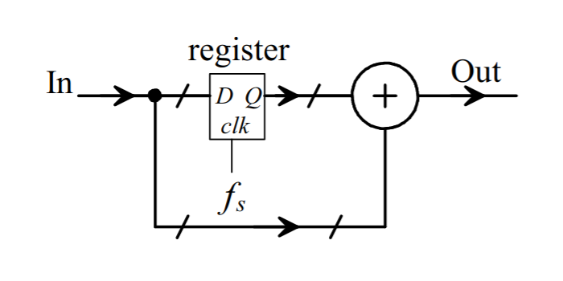
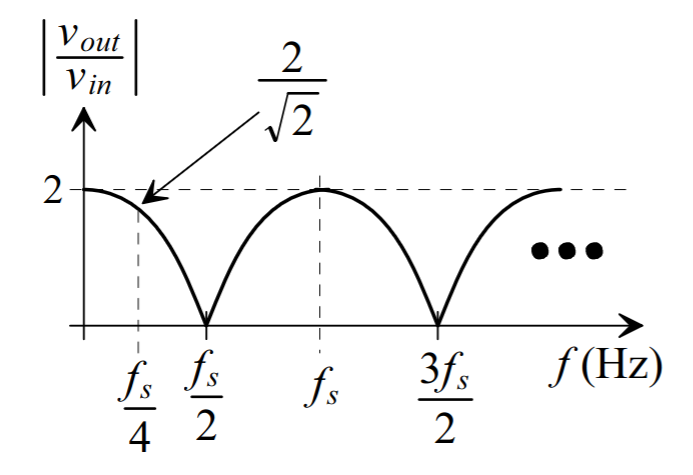
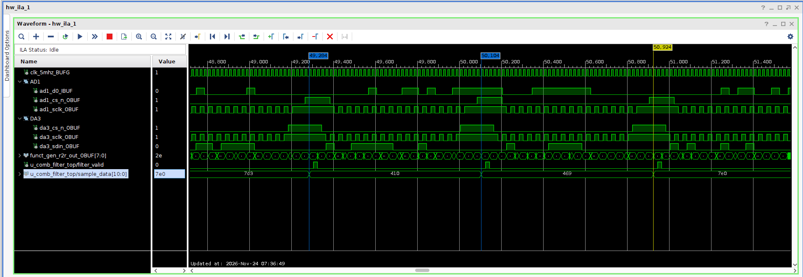

<!---

This file is used to generate your project datasheet. Please fill in the information below and delete any unused
sections.

You can also include images in this folder and reference them in the markdown. Each image must be less than
512 kb in size, and the combined size of all images must be less than 1 MB.
-->

## How it works

Comb filters are a simple type of system that rejects signals near, or exactly at, half of the system sampling frequency.

*Comb filter block diagram, taken from [1]*

It works by adding a delayed version of a sample to the current sample. In this way, once the frequency of the input signal starts approaching the filter sampling frequency (dictated by how often the ADC delivers samples), destructive interference occurs, causing rejection (or simply nulling) due to the nearly identical magnitudes and opposite signs of the previous and current samples.

*Magnitude response of a comb filter, taken from [1]*

Furthermore, to implement this behavior, it was necessary to manipulate the data in the filter because the ADC only works from 0 V to 3.3 V, so by default there is no way to capture negative samples. To solve this, data centering was applied so that every sample is shifted around a mean reference value. For example, samples between 0 V and 1.65 V are considered negative and, consequently, samples between 1.65 V and 3.3 V are considered positive. Finally, it is worth mentioning the reconfigurable behavior of this design through the programmed system clock value and how the SPI master derives SCLK from it. Since the ADC delivers one new sample every fixed number of SCLK cycles, the sampling frequency is a function of the system clock.

Some technical specifications:
1. SPI interface for ADC was designed for PMOD AD1.
2. SPI interface for DAC was designed for PMOD DA3.
3. The ADC delivers 12-bit data, so the datapath is 12 bits wide before the addition. After addition, it becomes 13 bits wide, so it can accommodate overflow in the worst case. The DAC still handles this, since it supports up to 16 bits.
4. SCLK should be greater than 1 MHz, otherwise the track and hold capacitance of PMOD AD1 may fail.
5. SCLK should not exceed 20 MHz.

Further work:
1. Explore feedback topologies of comb filters.
2. Add more than one delay stage (i.e., register) in the datapath, so more nulls or spikes can appear before the Nyquist frequency and aliasing effects can be reduced.

References:

- [1] 2nd Edition: R. J. Baker, CMOS Mixed-Signal Circuit Design, 2nd ed. Piscataway, NJ, USA: IEEE Press / John Wiley & Sons, 2009
- [2] Dr.-Ing Montero-Rodriguez, J-J, Diseño de Circuitos Integrados en Señal Mixta, Maestría en Electrónica, Escuela de Ingeniería Electrónica. Instituto Tecnológico de Costa Rica, 2025.

## How to test

Configure a system clock value and calculate the system sampling frequency in advance. For example, with a 5 MHz system clock, SCLK is 2.5 MHz (it takes two system clock cycles to generate one SCLK cycle, one for the positive edge and one for the negative edge). Considering one new sample every 16 SCLK cycles, plus the overhead for guard cycles and data transfer between the FSM and filter datapath (more details below), the sampling frequency is 121.95 kHz. Based on comb filter theory, the first null (and the only achievable one, due to aliasing effects) occurs at half the sampling frequency, which is approximately 60.5 MHz. In other words, if you configure a 60.5 MHz sine tone, you will see the output become a DC value at VDD/2, since the spectral content is removed. As you approach this value, you will notice the output amplitude decreasing.

In summary
$$
f_{sampling} = \frac{f_{sys\_clk}}{41}
$$

Where,

$$
41 = K + 1 + 1 + (2N + E) + H + 1 + 1
$$ 
$$
N = 16 \,\text{(SPI bits per AD1 transfer)}
$$ 
$$
E = 1 \,\text{(extra frame-end edge)}
$$ 
$$
H = 2 \,\text{(CS hold ticks)}
$$ 
$$
K = 2 \,\text{(FSM CS-high wait cycles)}
$$

To validate this design using real PMOD boards and timing constraints, FPGA emulation was used by targeting a Nexys Video FPGA board with the AMD Vivado flow. After configuring a debug core, access to internal fabric signals was obtained and the following waveforms were captured. Using the 100 MHz reference clock for the ILA core and an internal clock divider (not part of the Tiny Tapeout design presented here, only a helper module), a 5 MHz clock was generated. Since each sample was taken at 100 MHz, each cycle period was 10 ns, and the sample delta (see markers) was $50104-49284=820$ samples. This translates to $820\times10\,ns=8200\,ns$, or 121.95 kHz. Please also notice the behavior of the SPI interfaces for the AD1 and DA3 PMODs. Finally, the FPGA board was also used to implement a function generator module attached to a PMOD R2R board.

*Waveforms of the emulated design on a Nexys Video FPGA board, captured using AMD Vivado*

If you are interested in how this was tested, please check this other repository: <https://github.com/fabianpg3/comb_filter>. It includes a UVM environment for functional verification and an FPGA flow for emulation and testing on real hardware using the PMODs and the Nexys Video board.

Pictures of the experimental setup mounted in the laboratory can be found in the docs/ folder of this project repository.

Finally, here is a video with captured live behavior: [YouTube video](https://youtu.be/b6mxWUtuAvc)

## External hardware

1. PMOD AD1.
2. PMOD DA3.
3. Frequency generator (for the input signal). Note: values should be between 0 V and 3.3 V; otherwise, damage can occur to the PMOD AD1 board.
4. Oscilloscope (to visualize the output signal).
5. Set up a system clock reference on the Tiny Tapeout board or provide an external clock signal from 1 MHz to 40 MHz.

---

I want to express my gratitude to my family. Thank you for always believing in me and encouraging me to keep learning and exploring new boundaries. I also want to thank Instituto Tecnologico de Costa Rica, especially the Department of Electronic Engineering, as well as Rydev Inc. for all of the support. It was very rewarding to apply the knowledge and experience I gained in the mixed-signal course.
