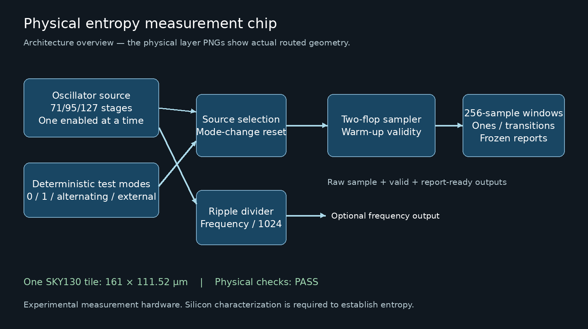

## How it works

This experimental chip measures physical ring-oscillator samples. It is a learning
and characterization device; it does not provide validated cryptographic random
numbers. Three odd-inversion rings (71, 95 and 127 stages) use fixed two-row
placement. Only the selected ring runs. Ring enables are registered one-hot
flip-flops: a ring starts one clock edge after its selection is captured, and
pin changes between clock edges cannot stop or restart it. Changing the ring
selection leaves every ring off for at least one clock period. Test-mode pins
never affect a running ring. ena and reset still stop the ring without a clock.
A two-flop synchronizer samples the source on the project clock. Two acquisition
edges fill the pipeline; the third edge counts the first sample. For ring sources
this warm-up starts on the edge that starts the ring. Each nonoverlapping window counts 256 samples and the
255 transitions within that window. Reports can be frozen while sampling continues.
Changing source or test configuration discards the partial window and restarts
warm-up. Completed reports retain the configuration that produced them. For
characterization, disable acquisition, hold the old request for at least two
20 ns clock periods, apply and clock the new request, wait at least two more
periods after capture, then re-enable. The firmware helper enforces separate
manual-clock phases with three cycles before and after the request. Arbitrary
enabled source changes are not a qualified operating protocol.

Source selection UI7:UI6 = 0/1/2 chooses the three rings; 3 selects a test mode.
Test selection UIO5:UIO4 = 0/1/2/3 chooses zero/one/alternating/external UIO6.
UI3 enables acquisition, UI4 freezes reports and UI5 enables a frequency output
on UIO3. That output is the selected ring frequency divided by 1024, with no
specified startup phase. UI2:UI0 selects a read register on UO7:UO0.
UIO0 is the sampled bit, UIO1 sample-valid and UIO2 report-ready. UIO4..6 are
inputs; UIO7 is unused. A deselected project masks outputs and releases UIO pins.

| Address | Register |
|---|---|
| 0 | Status: valid bit 0, ready bit 1, active bit 2, freeze bit 3, completed constant-window flag bit 4 |
| 1 | Completed-window generation, wraps modulo 256 |
| 2 | Ones count bits 7:0 |
| 3 | Ones count bit 8 at bit 0; report test mode at bits 2:1; report source at bits 4:3 |
| 4 | Transition count bits 7:0 |
| 5 | Transition count bit 8 at bit 0 |
| 6 | Live window progress, modulo 256 |
| 7 | Interface version: 2 |

The flag for a constant window is a diagnostic, not an entropy health test.
Asynchronous sampling, bias, oscillator locking and metastability require real
silicon characterization. There is no conditioner, entropy estimate or security
certification. Timing targets a 50 MHz project clock and assumes an internal ring
below 500 MHz. Deterministic transistor corner models support this assumption;
they do not establish entropy or guarantee manufacturing yield.

## How to test

Select this project with its shuttle-compatible Tiny Tapeout DemoBoard SDK.
Stop automatic clocking, hold the clock low and keep MCU UIO0..3 as inputs.
Assert active-low reset for at least one project-clock rising edge, then release.
Keep controls stable across clock edges. Begin with a 100 kHz project clock.

1. Read address 7 and expect 2. Keep UI3 low. Select source 3 and test mode 0,
   clock three times to apply/settle configuration, then enable UI3 and clock
   258 more edges. Expect one
   completed window: generation 1, ones 0, transitions 0, report source 3/mode 0.
2. After reset, test mode 1 must report 256 ones and zero transitions. Mode 2
   must report 128 ones and 255 transitions. For mode 3, drive UIO6 with a known
   stream and compare reports against the captured settled samples.
3. Assert UI4, clock once, and check that generation/counts stay unchanged over
   at least 600 more edges. Clear UI4 and verify reporting resumes. Disable UI3:
   validity clears, partial acquisition is discarded and completed reports remain.
4. Select physical sources 0, 1 and 2 separately using the disabled protocol
   above (or the guarded firmware helper). Enable UI5 and measure UIO3;
   multiply its stable frequency by 1024. Record supply, temperature and source.
   Changing modes may make startup pulses irregular; measure only after settling.
5. Copy the repository firmware helpers to the board. Validate finite PIO/DMA
   capture against alternating test mode before collecting oscillator samples.
   Check clock phase/rate and stalls. The helper has not yet been hardware tested.
   It captures at most 32768 samples, not a validated long entropy dataset.

To read a coherent report, assert UI4 and apply an edge before reading addresses
0..5, then clear UI4. Decode the ninth count bit separately from configuration.
Read raw sample/valid before a rising edge to match the sample counted by the
chip at that edge. Board propagation delays must be checked experimentally.
Start with deterministic tests; simulation results are available in the repository.

## External hardware

A Tiny Tapeout devkit/carrier compatible with the selected SKY130 shuttle and its
USB cable are required. The board uses 3.3 V I/O; never apply 5 V. No PMOD or
custom PCB is required for initial digital testing. A suitable logic analyzer or
validated PIO/DMA capture can measure the divided frequency output. Do not buy
additional acquisition hardware until the supplied board's capture is evaluated.
