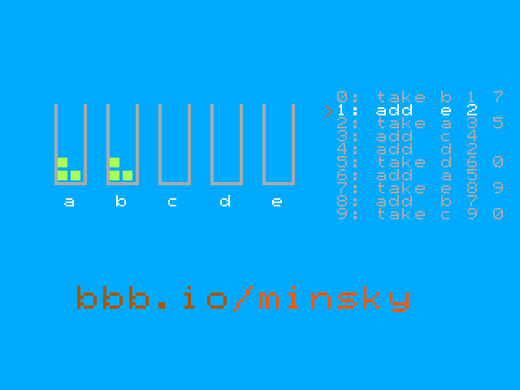

<!---
This file is used to generate your project datasheet.
-->

## How it works

In 1967 Marvin Minsky showed that a computer needs very little to compute
anything at all: a few boxes that hold pebbles, and two instructions.

- **add *r*** puts one pebble in box *r* and goes on to the next instruction.
- **take *r*** takes one pebble out of box *r* and goes on to the next
  instruction, but if box *r* is empty it jumps somewhere else instead.

This chip contains such a machine and shows it working on a VGA monitor.

**The machine.** Five boxes, a to e, and a program counter, in
`src/minsky_machine.v`. It runs the program in `src/demo_program.v`:
Minsky-style multiplication. It multiplies a = 3 by b = 4 into c
(12 pebbles), puts a and b back, empties c and starts again, every 99
instructions. It runs one instruction every 16 frames (about four a
second), slowly enough to watch: a full cycle takes about 26 seconds.

**The screen.** The left of the screen shows the five boxes with their
real pebbles; the right shows the program, with an orange `>` at the
instruction being run. The listing is drawn from the same table the
machine executes. Each line reads: line number, instruction, box, next
line, and (for `take`) the line to go to if the box is empty. The picture
is 640 x 480 at 60 Hz, from standard VGA timing (`src/vga_sync.v`); the
text uses a small font stored as ASCII art in `src/font.v`.

The colours are the BeagleBoard.org brand colours, as close as 2 bits per
channel allows; the link bbb.io/minsky is in hair brown and tongue orange,
like the BeagleBoard.org logo.

## How to test

1. Connect the Tiny VGA Pmod to the output pins and a monitor to the Pmod.
2. Set the clock to 25.175 MHz (25 MHz works on most monitors) and reset.
3. Watch the pebbles move between boxes a to e as the `>` steps through
   the program, and c fill up to 3 x 4 = 12.

In simulation, `test/render_frame.v` writes frames as images and checks the
sync timing, and `make` in `test/` runs the cocotb tests.

## External hardware

Tiny VGA Pmod (or any VGA Pmod with the same pinout), and a VGA monitor.
