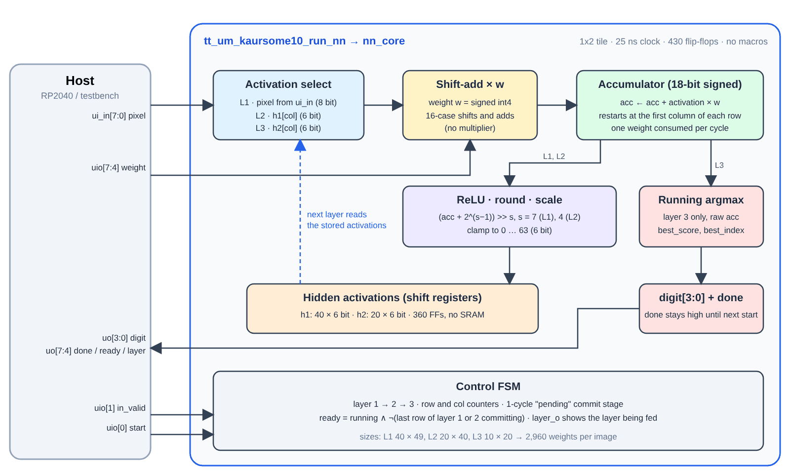
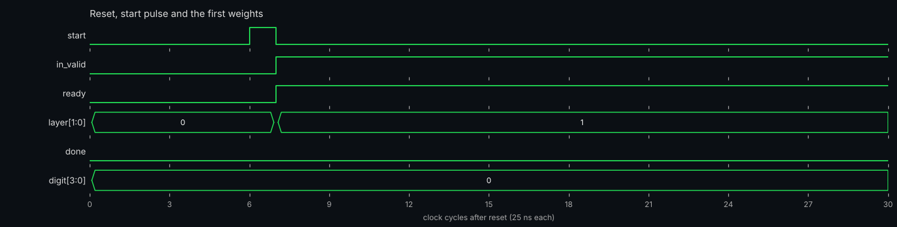
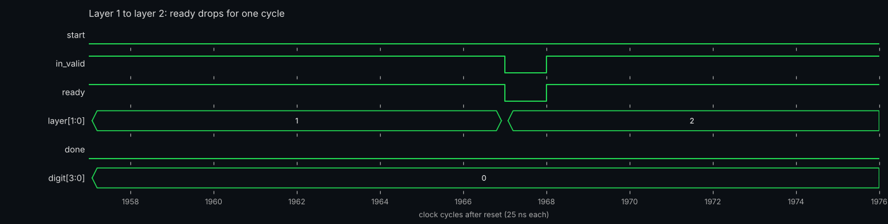
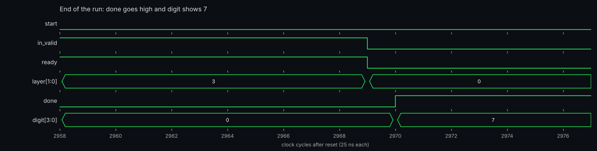
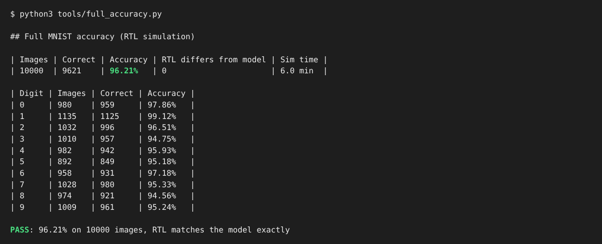

<!---

This file is used to generate your project datasheet. Please fill in the information below and delete any unused
sections.

You can also include images in this folder and reference them in the markdown. Each image must be less than
512 kb in size, and the combined size of all images must be less than 1 MB.
-->

## How it works

This project is a small neural-network inference engine that recognises handwritten digits (MNIST). It runs a
quantized 3-layer fully connected network on a 7×7 grayscale image and outputs the predicted digit, 0 to 9.

| | |
|---|---|
| Network | 49 → 40 → 20 → 10 (three fully connected layers) |
| Input | 7×7 image, unsigned 8-bit pixels (the 28×28 MNIST image average-pooled in 4×4 blocks by the host) |
| Weights | signed 4-bit (−8 … 7), 2,960 in total: 1,960 + 800 + 200 |
| Activations | 6-bit unsigned after ReLU, rounding and scaling |
| Accuracy | **96.21 %** (9,621 / 10,000) on the full MNIST test set, measured in RTL simulation |
| Clock | 40 MHz (25 ns period) |



**One MAC for the whole network.** All three layers share a single multiply-accumulate unit that handles one weight
per clock cycle. The multiplier is replaced by a 16-case shift-and-add table, because the weight is only a signed
4-bit number. The sum is kept in an 18-bit accumulator.

**Weights are streamed in, not stored.** The chip has no weight memory. The host sends every weight, in row-major
order, one per clock cycle. Layer 1 also needs the matching pixel on `ui_in` for each weight, so each of the 49
pixels is sent once per layer-1 neuron. In layers 2 and 3 the activations come from the chip's own registers
and `ui_in` is ignored.

**Layer by layer.**

1. **Layer 1:** 40 neurons × 49 inputs. After each neuron's 49 weights the result goes through ReLU, adds a
   rounding constant, shifts right by 7 and clamps to 0…63. The 6-bit value is stored in `h1`.
2. **Layer 2:** 20 neurons × 40 inputs, read from `h1`. Same ReLU, rounding and clamp, with a shift of 4. Stored in `h2`.
3. **Layer 3:** 10 neurons × 20 inputs, read from `h2`. No ReLU or scaling. A running argmax keeps the best score and its
   index. The first maximum wins on ties.

`h1` and `h2` are rotating shift registers (360 flip-flops in total), so no read multiplexer is needed to pick the
activation for the current column. The design uses no SRAM or other macros.

**Flow control.** The chip tells the host when it is accepting data through the `ready` output. `ready` is high while an
image is running, except for one cycle after the last weight of layer 1 and one cycle after the last weight of layer 2,
while the final neuron of that layer is stored. The host sends an element only on cycles where `ready` is high.

## How to test

### Pins

| Pin | Name | Direction | Meaning |
|---|---|---|---|
| `ui_in[7:0]` | pixel | in | Pixel for the current weight (0…255). Used in layer 1 only. |
| `uio[0]` | start | in | Pulse high for one clock to begin an image. |
| `uio[1]` | in_valid | in | High on every cycle that carries a weight. Cycles with it low are ignored, so the host may also pause between weights. |
| `uio[2]`, `uio[3]` | – | in | Unused. |
| `uio[7:4]` | weight[3:0] | in | Signed 4-bit weight, two's complement, `uio[4]` is bit 0. |
| `uo[3:0]` | digit | out | Predicted digit, valid once `done` is high. |
| `uo[4]` | done | out | Goes high when the result is ready and stays high until the next `start`. |
| `uo[5]` | ready | out | High when the chip accepts an element on this cycle. |
| `uo[7:6]` | layer | out | Layer currently being fed (1, 2 or 3). 0 when no image is running. |

`rst_n` is asynchronous and active low. All `uio` pins are inputs (`uio_oe = 0`).

### Sequence for one image

The waveforms below are simulation output for the first MNIST test image, a 7.



1. Reset the chip (`rst_n` low for a few cycles, then high).
2. Pulse `start` for one clock cycle, with `in_valid` low.
3. **Layer 1:** for `r` in 0…39 and `c` in 0…48, wait until `ready` is high, then drive `ui_in = pixel[c]` and
   `weight = W1[r][c]` with `in_valid = 1` for one clock cycle. This is 1,960 elements.
4. After the last layer-1 element `ready` drops for one cycle. Keep `in_valid` low until it is high again.
5. **Layer 2:** send `W2[r][c]` for `r` in 0…19 and `c` in 0…39 (800 elements). `ui_in` is ignored.
6. `ready` drops for one cycle again after the last layer-2 element.
7. **Layer 3:** send `W3[r][c]` for `r` in 0…9 and `c` in 0…19 (200 elements).
8. Wait for `uo[4]` (done) to go high, then read `uo[3:0]`. A full image takes 2,963 clock cycles from `start` to
   `done` (about 74 µs at 40 MHz).

The layer 1 → layer 2 transition: `ready` drops for one cycle after the last layer-1 weight.



The end of the run: `done` goes high and `digit` shows 7.



Pseudocode for the host:

```python
def classify(pixels, W1, W2, W3):      # pixels: 49 ints 0..255, W*: flat row-major lists of ints -8..7
    pulse_start()                       # uio[0] high for one clock, in_valid low
    for r in range(40):
        for c in range(49):
            send(ui_in=pixels[c], weight=W1[r * 49 + c] & 0xF)
    for w in W2:                        # 20 x 40
        send(ui_in=0, weight=w & 0xF)
    for w in W3:                        # 10 x 20
        send(ui_in=0, weight=w & 0xF)
    while not done():                   # uo[4]
        clock(in_valid=0)
    return read_uo(3, 0)

def send(ui_in, weight):
    while not ready():                  # uo[5]
        clock(in_valid=0)
    clock(ui_in=ui_in, weight=weight, in_valid=1)
```

### Preparing the data

- **Weights:** the files `src/weights/weights_W1.mem`, `weights_W2.mem` and `weights_W3.mem` hold one weight per
  line as a single hex digit. It is a 4-bit two's complement value in row-major order (W1 is 40 × 49, W2 is 20 × 40,
  W3 is 10 × 20). A `.mem` digit can be sent as it is.
- **Pixels:** average-pool the 28×28 MNIST image in non-overlapping 4×4 blocks, round to the nearest integer,
  and flatten the result row by row into 49 values. `test/generate.py` does exactly this for the MNIST test set.

### Simulation

The cocotb testbench in `test/` streams the weights and a set of MNIST test images through the Tiny Tapeout wrapper
using only the chip pins, and compares every result against a bit-exact Python model of the network.
It also checks the `ready` behaviour and that `done` holds until the next `start`. Run it with `cd test && make`.

To run all 10,000 MNIST test images through the RTL, run `python tools/full_accuracy.py` from the repository root (needs
Icarus Verilog, takes several minutes). It prints the accuracy and checks that the chip agrees with the Python model in
`tools/evaluate_mnist.py` on every image. This run is not part of the GitHub Actions CI.



## External hardware

The chip does not store its weights, so a **host controller must stream them in on every inference**.
On the Tiny Tapeout demo board this can be the on-board RP2040, which also provides the clock. The
host needs to hold the 2,960 weights (about 1.5 KB when packed as nibbles) and, for each image, the 49 pooled pixel values.

Nothing else is needed. All inputs and outputs are plain digital signals, and the result can be read from `uo[3:0]` or
shown on LEDs.

The chip is designed for a 40 MHz clock (25 ns period), but the host that feeds the weights sets the practical speed.
A host that cannot sustain one weight per clock can drive a slower clock, or step the clock once per weight.
