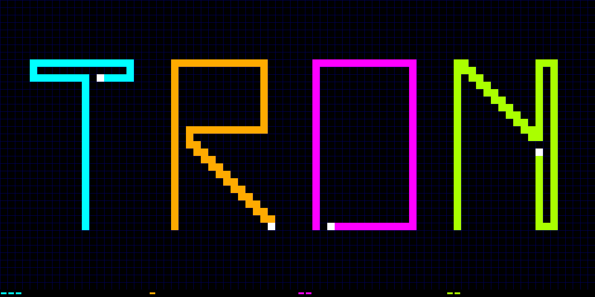

## How it works

Four player light cycles on an 800x600 VGA screen. Each player leaves a trail, and running into any trail, or into another player head on, is fatal. The last player alive wins the round and gets a pip in the score strip along the bottom of the screen. The first to 12 wins the match. The edges wrap: leave the left side and you come back on the right, and the same for top and bottom.

The playfield is a 50x37 grid of 16 pixel cells. There is no framebuffer. Each trail is stored as a list of corners in one shared ring of 66, three to a word in a 32 x 32 bit register file (Sylvain Munaut's rf_top macro, set up as in Uri Shaked's SIC-1). A corner is 9 bits: the owner, which way the trail left, and just the coordinate that changed, since consecutive corners share the other. Each trail's first point is kept in a register. Wraps need no corners, because a straight segment can't go all the way round without hitting its own start. When the ring is full the newest corner overwrites the oldest, so the oldest trail loses its first segment rather than the game running out of memory.

A query engine works out who owns any cell by scanning the ring, one entry per clock, then the four live segments from each player's newest corner to its head. The renderer asks it about all 50 cells of the next row while the current row is on screen, filling a line buffer held in the rest of the register file. The game tick asks it about the cell each head is about to enter during vertical blank, which is all the collision detection there is. Bots use it in the same way to look ahead, left and right before they move.

## How to test

### Setting up

- Plug the **Tiny VGA Pmod** into the **output** Pmod header (uo_out), and a VGA monitor into it. The design needs a 40 MHz clock.
- To play with controllers, plug the **Gamepad Pmod** into the **input** Pmod header (ui_in), with one or two SNES controllers. Turn DIP switches 5 to 7 off: they share its pins.
- To play from the TT Commander instead, leave the input header empty.
- The speed is read from ui[1:0] (DIP switches or Commander inputs 1 and 2) while the design is held in reset: 0 for 10 moves a second, 1 for 15, 2 for 8.6.

After reset the design takes about 2 seconds to decide which controls are in use, and ignores inputs meanwhile. A small mark at the right end of the score strip shows what it decided: white for the Gamepad Pmod, blue for the Commander.

### With the Gamepad Pmod

Press one of your turn buttons to join, then Start on either controller to start a round.

Each controller is shared by two players, who each use only two buttons to turn left or right relative to the way they are heading:

| Player | Colour | Controller | Left | Right |
|---|---|---|---|---|
| 0 | cyan | 1 | D-pad left | D-pad right |
| 1 | orange | 1 | Y | A |
| 2 | magenta | 2 | D-pad left | D-pad right |
| 3 | lime | 2 | Y | A |

### From the TT Commander

With no Gamepad Pmod, set the Commander's inputs to momentary mode and use keys 1 to 8 (ui[0] to ui[7]), two per player, left then right:

| Player | Colour | Left | Right |
|---|---|---|---|
| 0 | cyan | 1 | 2 |
| 1 | orange | 3 | 4 |
| 2 | magenta | 5 | 6 |
| 3 | lime | 7 | 8 |

Press one of your keys to join, then both of your keys at once to start a round.

The design tells the Gamepad Pmod and the Commander apart by itself: the Pmod sends each report as a burst of fast clock pulses before a latch, at least once a second, which nobody pressing keys can do. With no report for 2 seconds it switches to the Commander's keys.

Once the Commander has been connected, the demo board's microcontroller keeps driving the ui_in pins, even after the Commander is closed or the design is reset. Power cycle the board before plugging the Gamepad Pmod back in, or the two fight over the pins (the mode mark shows blue).

### Joining, bots and attract mode

Any player nobody is controlling is played by a bot: it drives straight on, turns into a free cell when it is about to hit something, and now and then turns at random. A player becomes human as soon as one of its turn buttons is pressed, and stays human until the game goes back to attract mode. A turn button pressed before the round starts only joins you; it doesn't turn you.

After 30 seconds with no button pressed between rounds, everyone becomes a bot again and rounds start by themselves: an attract mode, which also starts about a second after reset. Start or any turn button ends it and goes back to the start positions, where players' heads blink until they join and show solid white once they have. Then press Start.

When a round ends the winner's trail flashes and they get a pip in the score strip. When someone reaches 12, every pip flashes for about 2 seconds, then all the scores go back to 0 and the next round can start.

## External hardware

- [Tiny VGA Pmod](https://github.com/mole99/tiny-vga) on the output Pmod header, and a VGA monitor
- [Gamepad Pmod](https://github.com/psychogenic/gamepad-pmod) on the input Pmod header, with one or two SNES compatible controllers; or none, to play from the [TT Commander](https://commander.tinytapeout.com)
