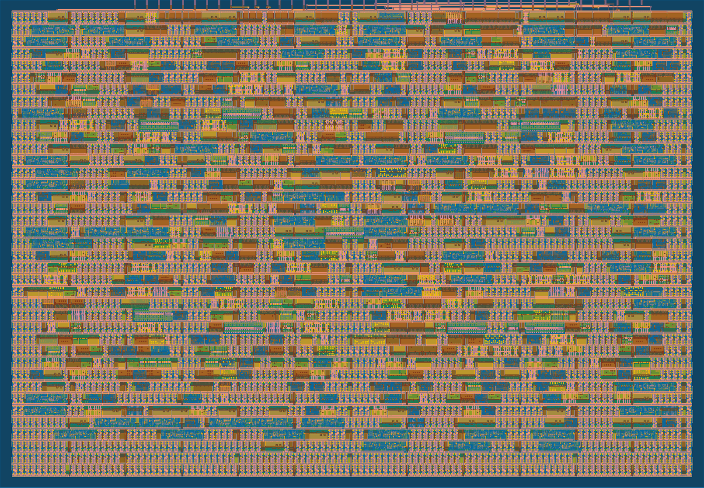

## How it works
 
This project implements a 32-bit arithmetic and logic unit (ALU) with two 32-bit operands, `A` and `B`, a 3-bit operation code, and a 32-bit result. The operation code selects one of eight functions: four arithmetic operations and four bitwise logical operations. The ALU core is combinational; once `A`, `B`, and the operation code are stable, the result follows after the normal propagation delay of the synthesized logic.
 
| Opcode | Operation | Definition |
|---|---|---|
| `000` | ADD | `A + B` |
| `001` | SUB | `A - B` |
| `010` | INC | `A + 1` |
| `011` | DEC | `A - 1` |
| `100` | AND | `A & B` |
| `101` | OR | `A \| B` |
| `110` | XOR | `A ^ B` |
| `111` | NOT | `~A` |
 
The external Tiny Tapeout interface is narrower than the internal datapath. `ui_in[7:0]` and `uo_out[7:0]` carry one byte at a time, whereas each operand and the complete ALU result are 32 bits wide. The wrapper therefore stores `A` and `B` in two internal 32-bit registers. A 32-bit word is divided into four bytes, and each byte is written to an explicitly selected byte position on a rising clock edge.
 
Control is supplied on `uio_in`. Bits `uio_in[2:0]` form the wrapper command, while `uio_in[4:3]` select one of the four byte positions. The remaining `uio_in` bits are reserved. The bidirectional pins are configured as inputs for this design (`uio_oe = 0`), so no project data are driven back through `uio_out`.
 
| Command | Function |
|---|---|
| `000` | Write one byte of operand A |
| `001` | Write one byte of operand B |
| `010` | Load the 3-bit ALU opcode from `ui_in[2:0]` |
| `011` | Select one byte of the 32-bit result for `uo_out[7:0]` |
| `100`-`111` | Reserved; no state is changed |
 
| `uio_in[4:3]` | Selected bits | Byte number |
|---|---|---|
| `00` | `[7:0]` | 0 (least significant byte) |
| `01` | `[15:8]` | 1 |
| `10` | `[23:16]` | 2 |
| `11` | `[31:24]` | 3 (most significant byte) |
 
The wrapper is sequential because it must retain the four input bytes that make up each operand and remember the selected output byte. The ALU itself remains combinational and has no internal execution state. No separate execute command is required: loading a new opcode or operand changes the combinational result automatically.
 
The 32-bit result is presented through a 4-to-1 byte multiplexer. The selected byte appears on `uo_out[7:0]`. Arithmetic is performed modulo `2^32`; carry, borrow, signed overflow, and condition flags are not exposed by this version of the design. The active-low reset clears both operands, selects ADD as the default opcode, and selects result byte 0.


 ### Physical implementation

The design was implemented in a single 1x1 SKY130 Tiny Tapeout tile. The final physical design uses 69 flip-flops for the two 32-bit operand registers, 3-bit opcode register, and 2-bit output selector. The SKY26d implementation passed the Tiny Tapeout physical precheck and gate-level functional verification.



## How to test
 
A complete transaction consists of loading operand A, loading operand B, loading the operation code, and reading the four result bytes.
 
1. Drive `rst_n` low for several clock cycles, then release it high.
2. For operand A, issue command `000` four times. Place the desired byte on `ui_in[7:0]` and use `uio_in[4:3]` to select byte positions 0, 1, 2, and 3.
3. For operand B, repeat the same procedure with command `001`.
4. Issue command `010` and place the required ALU opcode on `ui_in[2:0]`.
5. Issue command `011` with the required byte-select value. After the selector has been captured on a rising clock edge and the output logic has settled, read `uo_out[7:0]`. Repeat for all four bytes.
6. Reassemble the four bytes to obtain the complete 32-bit result.
 
### Worked example: 32-bit addition
 
Let
 
```text
A      = 0x12345678
B      = 0x01020304
opcode = 000   (ADD)
```
 
Load operand A:
 
| Byte select | `ui_in[7:0]` |
|---|---|
| `00` | `0x78` |
| `01` | `0x56` |
| `10` | `0x34` |
| `11` | `0x12` |
 
Load operand B:
 
| Byte select | `ui_in[7:0]` |
|---|---|
| `00` | `0x04` |
| `01` | `0x03` |
| `10` | `0x02` |
| `11` | `0x01` |
 
The ALU computes:
 
```text
0x12345678 + 0x01020304 = 0x1336597C
```
 
Reading result bytes 0 through 3 gives `0x7C`, `0x59`, `0x36`, and `0x13`. Reassembling the bytes produces `0x1336597C`.
 
The repository also contains a Cocotb verification suite that exercises all eight operations using directed corner cases and deterministic randomized 32-bit operands. The same test is used by the Tiny Tapeout gate-level workflow after physical implementation.
 
## External hardware
 
No external hardware is required for RTL or gate-level simulation. After fabrication, the design can be exercised with the Tiny Tapeout demoboard. Its controller provides the project clock, reset, input data, and control signals, and reads the selected 8-bit result byte from the dedicated output bus.
